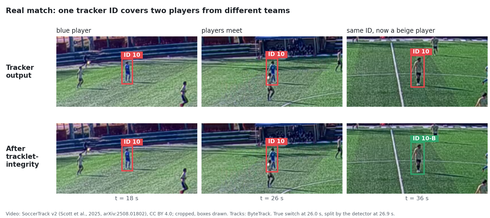
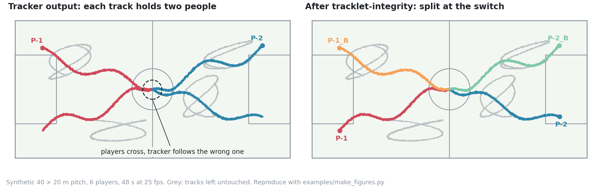
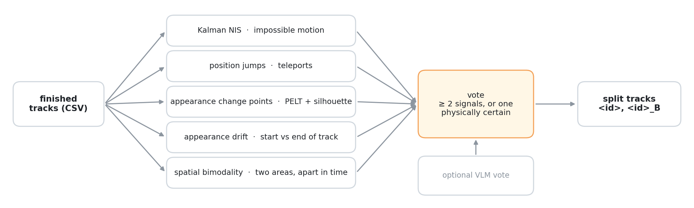
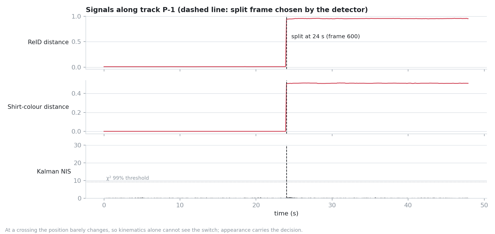

# tracklet-integrity

**Find and split player tracks that silently switched to a different person.**

When two players cross or occlude each other, a multi-object tracker often keeps the same ID but
continues on the wrong player. The track looks continuous, yet every number computed from it
(distance, heatmap, sprints) mixes two people. This project takes finished tracks, finds the ones
that contain more than one identity, and cuts them at the frame where the switch happened.



*A real case from a public full-pitch match ([SoccerTrack v2](https://github.com/AtomScott/SoccerTrack-v2), CC BY 4.0), tracked with ByteTrack.*

## How it works



*The same situation on synthetic data, where the ground truth is known (reproduce with `python examples/make_figures.py`).*



Every track is checked by several independent signals, and a split needs them to agree:

- **Motion** – a Kalman filter scores how surprising each new position is (NIS) and flags jumps no player could make.
- **Appearance** – ReID embeddings and shirt colour along the track; change points are found with PELT and must form well-separated segments.
- **Space** – positions that fall into two areas of the pitch, one after the other in time.

A track is split when at least two signals fire, or when one is physically unambiguous (e.g. a jump of 15 m or more within a few detections). Weak or single-signal candidates are left alone rather than guessed. An optional vision-language model can add one more vote.



*At a crossing, positions stay continuous, so the Kalman filter sees nothing; the appearance signals carry the decision.*

The repo also contains the ReID side: a script that builds a labelled crop corpus from tracker output, and fine-tuning of OSNet with part-based heads for football players.

## Quick start

No video or data needed (tested with Python 3.11):

```bash
pip install -r requirements.txt
python examples/make_synthetic.py demo.csv --scenario crossing   # 6 players, two swap at a crossing
python chimera_detector.py --csv demo.csv --out demo_split.csv
```

Expected: `P-1` and `P-2` are split at frame 600 into `P-1, P-1_B, P-2, P-2_B`; the other four tracks are untouched. Add `--no-swap` to the first command for a control run in which nothing is split.

Your own data: one row per track per frame with `frame_idx, track_id, x_field, y_field` and, if available, ReID / colour embeddings. Column list and options: [docs/DETAILS.md](docs/DETAILS.md#input-format).

## Status

- **Works on synthetic data**: planted swaps are split at the exact frame; clean tracks are not split.
- **Developed on one real amateur 5-a-side match** (two cameras). The thresholds were tuned on that same match, so no accuracy figure is claimed for it.
- **First test on a full-size pitch is not good yet.** On 60 s of a SoccerTrack v2 match (ByteTrack tracks, no ReID, colour only) the detector split 11 tracks. Checked by eye: **2 were real identity switches, 9 were false alarms**. Most false alarms come from the "two areas of the pitch" signal, whose 10 m threshold was set for a 40 × 20 m pitch; on a 105 × 68 m pitch a player covers that distance in normal play. In the case shown above the split comes 0.9 s after the real switch. Scaling the thresholds with pitch size is the next fix.
- **Not yet benchmarked** on a public dataset (SportsMOT, SoccerNet-Tracking) or compared with tracklet splitters such as [GTA-Link](https://github.com/sjc042/gta-link). That is the next step.
- **Known limitation**: a swap at a crossing is only split when two appearance cues (ReID and colour) disagree; see [details](docs/DETAILS.md#status-and-honest-results).

Full technical notes – decision rule, every signal and threshold, input format, lessons learned – are in **[docs/DETAILS.md](docs/DETAILS.md)**.

No match videos, player images or trained weights are included: they show real people who did not consent to publication.

## License

Copyright (c) 2026. All rights reserved. The code is published to be read and reviewed; no licence is granted to use, copy, modify or distribute it ([LICENSE](LICENSE)). If you would like to use it, please get in touch.
